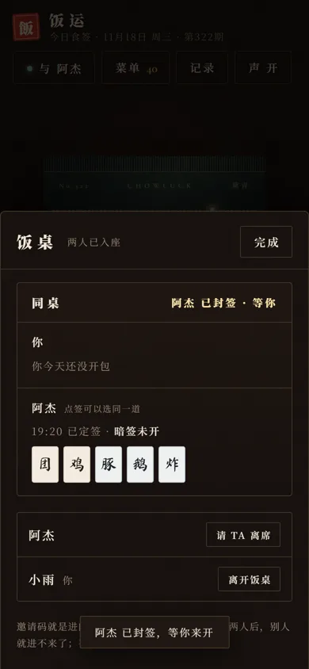
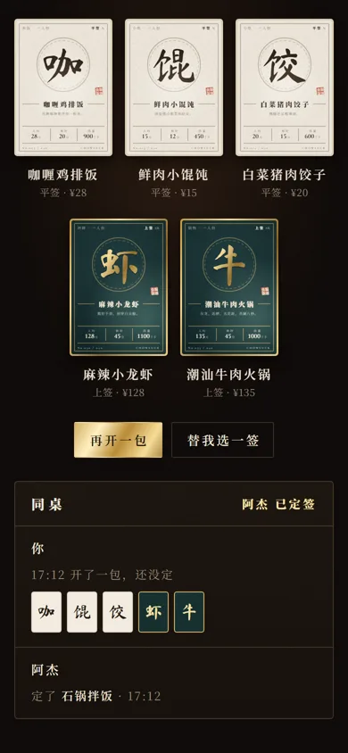

# 饭运抽卡 ChowLuck

两个人一起撕包抽签，决定今天吃什么。

"今天吃什么"是情侣、室友、搭子之间每天都会遇到的问题。饭运抽卡把它变成一个小仪式：
1. 撕开一包"食签"，翻出五道菜。
2. 各自挑一签，先盖着。
3. 两人都定了，再一起翻开，看是不是心有灵犀。

*A two-player "what's for lunch" picker. Tear open a foil pack of five dish cards, flip them one by one, and stamp the one you'll eat. Share a table with your partner: picks stay sealed until both of you have chosen, then flip together. Vite + TypeScript front end, Hono + node:sqlite back end, no framework, no external services, fonts self-hosted.*

<p align="center">
  
  
</p>
<p align="center">
  
</p>
<p align="center">
  
  
  
  
</p>

## 目录

- [特点](#特点)
- [快速开始](#快速开始)
- [玩法详解](#玩法详解)
- [抽签规则](#抽签规则)
- [数据存在哪里](#数据存在哪里)
- [架构](#架构)
- [开发指南](#开发指南)
- [接口](#接口)
- [自己部署](#自己部署)
- [常见问题](#常见问题)
- [后续计划](#后续计划)
- [许可证](#许可证)

## 特点

- **真的能撕**：卡包的封口沿一条锯齿线被你的手指一点点撕开，撕的时候还有纸张撕裂的声音。
- **五签一包**：翻牌节奏和真卡包一样，普通的在前，稀有的压轴。上签、上上签翻开前会先发光、轻轻颤动。
- **有质感的卡面**：每张卡正中是一个毛笔大字。签位越高材质越好，从宣纸到银箔，再到金箔、黑漆；金箔的反光会跟着鼠标或手指的角度流动。
- **两人同桌，暗签同开**：两个人共用一份菜单。对方定了签，你只知道 TA 定了，不知道选的是哪道；两个人都定了，再一起翻开。
- **服务端说了算**：抽签和掷签都在服务端完成，暗签也在服务端遮住。所以抓包也看不到对方的选择，两边看到的掷签结果也一定相同。
- **一个人也能玩**：不开饭桌时，所有数据都存在浏览器里，不需要任何后端。
- **零外部依赖**：没有用前端框架，没有外部服务，也不连 Google Fonts。三套字体都裁成了子集，自己托管，在国内网络下也能正常显示。
- **整套声音都是合成的**：撕包、翻签、钟声、盖章的声音，全部用 Web Audio 实时合成，项目里没有一个音频文件。

## 快速开始

需要 **Node.js 22.18 或更高版本**。从这个版本起，Node 可以直接运行 TypeScript，并自带 SQLite，不需要另装数据库，也没有需要编译的原生依赖。

```bash
git clone https://github.com/Amigosazul/ChowLuck.git
cd ChowLuck
npm install
npm run dev
```

打开 http://localhost:5173 就能玩。`npm run dev` 会同时启动两个服务：

| 服务 | 地址 | 说明 |
|---|---|---|
| 前端 | http://localhost:5173 | Vite 开发服务，改代码会自动热更新 |
| 接口 | http://localhost:8787 | Hono 后端；改代码会自动重启。前端会把 `/api` 请求转发到这里 |

想在一台电脑上试"同桌"功能，可以开一个普通窗口和一个无痕窗口，各自当一个人。

### 常用命令

| 命令 | 作用 |
|---|---|
| `npm run dev` | 同时启动前端和接口的开发服务 |
| `npm test` | 运行抽签算法和接口测试（Vitest） |
| `npm run typecheck` | 只做类型检查 |
| `npm run build` | 类型检查并打包到 `dist/` |
| `npm start` | 生产模式：一个进程同时提供页面和接口 |
| `npm run fonts` | 重新生成字体子集（见[字体](#字体)） |

### 环境变量

| 变量 | 默认值 | 说明 |
|---|---|---|
| `PORT` | `8787` | 服务端口 |
| `DB_PATH` | `data/chowluck.db` | SQLite 文件位置。目录不存在会自动创建；备份这一个文件就够了 |
| `APP_TIMEZONE` | `Asia/Shanghai` | 按哪个时区判断"今天"，到这个时区的零点就算新的一天 |

## 玩法详解

### 1. 撕包

打开页面先看到一个黑金的卡包。卡包每次随机三种配色之一：墨金、朱砂、黛青。

- **撕**：按住顶部的金色虚线，从左往右拖。封口会沿锯齿线一点点卷起来；拖过七成松手，会自动撕完。
- **不想撕**：点下面的"直接撕开"，或者聚焦卡包后按回车或空格。
- 撕开后，封口飞走，五张签从包里升起来，空包往下落走。

### 2. 翻签

- **点一下**：翻开最上面那张。
- **再点一下**：把它甩到一边，看下一张。
- 底部的"壹 贰 叁 肆 伍"表示翻到第几张了。
- 不想一张张翻，可以点"全部翻开"。

翻到稀有的签时，有专门的特效：

| 签位 | 卡面材质 | 翻开时 |
|---|---|---|
| 平签 N | 米白宣纸，墨字 | 普通翻面 |
| 中签 R | 冷白纸，银箔边、银箔字 | 一道扫光，少量银粉，一声钟 |
| 上签 SR | 深黛青底，金箔边、金箔字 | 翻开前先发光颤动；翻开后背后亮起旋转的金色光芒，金粉飘起，连响三声钟 |
| 上上签 SSR | 黑漆底，金箔字带虹彩 | 同上签，但光芒更亮，还会闪一下全屏的光，连响五声钟 |

### 3. 定签

五签翻完后排成一排；在电脑上会摆成扇形。

- 点任意一张会放大，可以拖着看金箔的反光。
- 点"定下这一签"，卡上会"啪"地盖下一枚朱红的"定"字印章。
- 拿不定主意，可以点"替我选一签"。
- 选好了还能改，再定另一签就行。

页面顶部会显示今天定了什么。已经开过包的话，在卡包页面点"看今天那包"，可以回到今天的结果。

### 4. 同桌

点右上角的"同桌"：

1. **开桌**：填一个称呼，就会得到一个 6 位的邀请码和一条邀请链接。你在单人模式里改过的菜单会一起带过去，今天已经定的签也会。
2. **邀请**：把链接发给 TA。TA 打开链接，填好称呼就能入座。也可以在"加入 TA 的饭桌"里手动输入邀请码。
3. **入座后**：
   - 两人共用一份菜单，谁改了都会同步给对方。
   - 对方开包、定签时，你会实时收到提示。
   - 结果页下方会出现"同桌"面板，左边是你，右边是 TA：看得到各自今天抽到的五签，以及定签状态。在面板里点对方的某一签，就能选同一道。

一张饭桌最多坐两人，坐满后邀请码就失效了。有人离席会空出座位，这时可以邀请新的人。

### 5. 暗签同开

这是两人模式的核心。

- **暗签**：你还没定签时，看不到对方选的是哪道，只显示"TA 已封签 · 等你"。对方抽到的五张签是看得到的，可以猜一猜 TA 会选哪张。
- **同开**：第二个人定签的那一刻，两边屏幕同时弹出揭晓。两张签先盖着出现，然后一起翻开。
  - **心有灵犀**：两人选了同一道菜。两张签都盖上"定"字章，飘起金粉，当天自动定案。
  - **两签不同**：可以选择：
    - **掷签决定**：服务端随机挑一签。两边看到同一段动画：亮光在两张签之间来回跳，越跳越慢，最后停在一张上盖章。
    - **改选 TA 的**：直接换成对方那道。两签一样了，就自动变成心有灵犀。
    - **先这样**：不定案，比如今天各吃各的。
- 揭晓动画在每台设备上只播一次，刷新页面不会重播。想再看一次，在同桌面板里点"重看揭晓"。
- 定了案又后悔，点"重新商量"就能撤销。

### 6. 菜单

点右上角的"菜单"：

- **停用**：点菜名就能停用或恢复。停用的菜不会被抽到；至少要保留五道才能开包。
- **添加**：可以添加自己的菜，比如楼下那家猪脚饭。需要填：
  - 菜名，最多 12 个字
  - 主字：卡面中间那个大字；不填就用菜名的第一个字
  - 类别
  - 签位
  - 人均价格

  等待时间和热量先用默认值，分别是 20 分钟和 700 千卡。
- **恢复默认**：清掉所有自定义的菜和停用设置。

### 7. 记录与声音

- **记录**：列出最近每天最后吃了什么。在饭桌模式下，还能看到两个人各自选了什么。
- **声音**：右上角"声 开 / 声 关"可以切换，设置会记住。

## 抽签规则

抽签逻辑在 `src/shared/draw.ts`，前端和后端共用同一份代码。

- 每包 5 签，同一包里不会重复。
- 前四签每一签独立随机签位：

  | 平签 N | 中签 R | 上签 SR | 上上签 SSR |
  |---|---|---|---|
  | 62% | 26% | 9% | 3% |

- 第五签是"保底签"，不会是平签：

  | 中签 R | 上签 SR | 上上签 SSR |
  |---|---|---|
  | 72% | 21% | 7% |

- 如果抽到的签位里已经没有可用的菜（被停用完了，或者已经在这包里出现过），就换到最近的签位。保底签优先往高找，其他签优先往低找。
- 前四签按签位从低到高排列，保底签放在最后，所以越往后翻越可能出好签。
- 默认菜单有 40 道菜：平签 18 道、中签 10 道、上签 7 道、上上签 5 道。上上签里还有一张"今天有人请客"。

在饭桌模式下，抽签由服务端完成。每人每天最多开 60 包。

## 数据存在哪里

### 单人模式：只存在浏览器里

| localStorage 键 | 内容 |
|---|---|
| `chowluck.local.v1` | 菜单设置，以及每天抽到的签和定下的菜。只保留最近 60 天 |
| `chowluck.sound` | 声音开关 |

不会发出任何网络请求。清掉浏览器数据，这些记录就没了。

### 饭桌模式：存在服务端

| 位置 | 内容 |
|---|---|
| 浏览器 `chowluck.session` | 这台设备的饭桌凭证 |
| 浏览器 `chowluck.seen.<饭桌>.<日期>` | 这台设备是否已经看过当天的揭晓 |
| 服务端 SQLite | 饭桌、成员称呼、共用菜单、每次抽签、每天的选择和定案 |

- **凭证**：开桌或入座时，服务端生成一个随机凭证。浏览器保存凭证本身，服务端只存它的 SHA-256 哈希。所以就算数据库泄露，也没法冒充别人。
- **邀请码**：6 位，去掉了容易看错的 `0 O 1 I L`。它就是进门的钥匙，坐满两人后自动失效。
- **暗签**：在服务端遮住。只要你今天还没定签，而且当天还没定案，返回给你的数据里，对方选的菜名就是空的。过去几天的记录不遮。
- **记录**：服务端返回最近 30 天的历史。

## 架构

```
浏览器                                         服务端（一个 Node 进程）
┌──────────────────────────────┐              ┌──────────────────────────────┐
│ ui/  卡包 · 翻签 · 结果 · 揭晓 │              │ app.ts   Hono 路由            │
│        │                     │   fetch      │   ├─ 鉴权（Bearer 凭证）       │
│ main.ts 状态与流程            │ ───────────► │   ├─ 抽签 / 定签 / 掷签       │
│        │                     │              │   └─ SSE：饭桌有变动就推送     │
│ store/ ├─ LocalStore 本机     │ ◄─────────── │ repo.ts  node:sqlite 读写     │
│        └─ RemoteStore 饭桌    │  SSE update  │          暗签在这里遮住        │
└──────────────────────────────┘              └──────────────────────────────┘
                 └────────── src/shared/  类型 · 默认菜单 · 抽签算法 · 日期 ──────────┘
```

- **同一套界面，两种存储**：界面只和 `Store` 接口打交道。单人模式用 `LocalStore`，数据存在浏览器里；饭桌模式用 `RemoteStore`，通过接口读写，所以两种模式共用同一套界面代码。
- **实时同步**：饭桌上任何一个人的操作，都会让服务端通过 SSE 推一条 `update`，另一个人的页面收到后，重新拉一次状态。断线重连后也会自动补拉。
- **状态先到，动画后放**：揭晓、掷签这些动画，都是前端对比前后两次状态后触发的。所以不管是自己操作的，还是对方操作后推送过来的，都会走同一套动画。

### 项目结构

```
src/shared/        前后端共用
  types.ts         数据类型
  dishes.ts        默认菜单、类别、签位名称
  draw.ts          抽签算法、菜单校验
  day.ts           按时区计算"今天"
src/client/        前端（Vite + TypeScript，不依赖框架）
  main.ts          状态与流程编排
  store/           LocalStore / RemoteStore / 接口封装
  ui/
    pack.ts        卡包与撕包手势（三层同图 + clip-path 锯齿）
    stack.ts       五签叠放与逐张翻开
    card.ts        卡面结构与跟随指针的倾斜、反光
    results.ts     扇形结果、放大、盖章
    reveal.ts      暗签揭晓与掷签动画
    table.ts       同桌面板
    sheets.ts      菜单 / 饭桌 / 记录三个弹出面板
    audio.ts       Web Audio 合成音效
    fx.ts          扫光、金粉
  styles/          设计令牌与各部分样式；fonts.css 由脚本生成
server/
  app.ts           接口路由与 SSE
  repo.ts          数据表与读写
  index.ts         启动入口；生产模式下同时提供 dist/ 里的页面
scripts/
  build-fonts.mjs  字体子集化
public/fonts/      字体子集与许可证
test/              Vitest 测试
```

### 数据表

| 表 | 主要字段 | 说明 |
|---|---|---|
| `rooms` | `id` `code` `pool` | 饭桌、邀请码、共用菜单（JSON） |
| `members` | `id` `room_id` `name` `token_hash` | 成员，每桌最多两人 |
| `draws` | `room_id` `member_id` `day` `cards` | 每次开包的五签 |
| `choices` | `room_id` `member_id` `day` `dish` | 每人每天的选择，改选会覆盖 |
| `finals` | `room_id` `day` `dish` `by` | 每天的定案。`by` 是成员 id，或者 `match`（心有灵犀）、`toss`（掷签） |

## 开发指南

### 改默认菜单

默认菜单在 `src/shared/dishes.ts`。每道菜一行：

```ts
d('黄焖鸡米饭', '鸡', '饭', 'N', 22, 25, 860, '酱汁浇在米饭上，能多吃一碗。'),
//  菜名        主字  类别  签位 人均 分钟 千卡  短评
```

- **类别**：饭、粉面、小吃、锅物、西餐、日韩、炙烤、河鲜，共八种。
- **签位**：`N`、`R`、`SR`、`SSR` 之一。
- **人均写 0**：显示为"免单"。
- **热量写 0**：显示为"随意"。

改完以后要重新生成字体子集，新出现的汉字才会用上毛笔字。

### 字体

使用了三套字体，都采用 SIL Open Font License 1.1：

| 字体 | 用在哪里 |
|---|---|
| 马善政毛笔楷书 Ma Shan Zheng | 卡面上的大字、"定"字印章 |
| 思源宋体 Noto Serif SC（可变字重 400–900） | 所有正文和标题 |
| Cormorant Garamond | 数字和英文 |

中文字体太大，不可能整个加载。`npm run fonts` 会下载源字体（缓存在 `.cache/fonts/`），按 `unicode-range` 把每套中文字体拆成两部分：
- **核心包**：扫描 `src/` 和 `index.html` 里出现过的所有字，打开页面时就加载，三套加起来约 485KB。
- **常用字包**：GB2312 一级的 3755 个常用汉字里，剩下的那部分。只有自定义菜名或称呼用到时，浏览器才会去下载，每套约 1.2–1.5MB。

GB2312 二级里的生僻字两个包都没有，会退回系统字体显示。

**改了界面文案或默认菜单、出现了新汉字时**，要重新运行 `npm run fonts`，并把 `public/fonts/` 和 `src/client/styles/fonts.css` 一起提交。

### 测试

```bash
npm test
```

- **`test/draw.test.ts`**：抽签算法。覆盖以下内容：
  - 五签不重复、保底签、排序
  - 停用的菜不会被抽到
  - 签位为空时换到相邻签位
  - 概率大致符合设定
  - 菜单校验，以及按时区计算日期
- **`test/api.test.ts`**：接口。直接调用 Hono 应用，使用内存数据库，不占端口。覆盖以下内容：
  - 开桌、入座、坐满
  - 鉴权、离席
  - 共用菜单
  - 心有灵犀、定案与重新商量
  - 跨天归档
  - 暗签遮挡与掷签

每次推送和 Pull Request，GitHub Actions 都会自动跑类型检查、测试和构建。

### 代码约定

- **服务端直接运行 `.ts` 文件**：靠的是 Node 的类型剥离，所以只能使用可以直接擦除的 TypeScript 语法（`tsconfig` 开了 `erasableSyntaxOnly`），比如不能用 `enum` 和构造函数参数属性。导入时要写完整的 `.ts` 扩展名。
- **样式**：颜色、字体都在 `styles/tokens.css` 里定义成变量，组件只用变量，不写死颜色。卡片内部全部用 `em`，所以改一个 `--cw` 就能整体缩放。
- **无障碍**：所有动画都尊重系统的"减少动态效果"设置；能点的地方都可以用键盘操作。

## 接口

除了开桌和入座，所有请求都要带上 `Authorization: Bearer <token>`。SSE 无法设置请求头，改用 `?token=<token>`。出错时统一返回 `{ "error": "中文错误说明" }`。

| 方法 | 路径 | 请求体 | 说明 |
|---|---|---|---|
| POST | `/api/rooms` | `{ name, pool? }` | 开桌，返回 `{ token }` |
| POST | `/api/rooms/join` | `{ code, name }` | 入座，返回 `{ token }`。邀请码不存在返回 404，已坐满返回 409 |
| GET | `/api/state` | | 当前状态（见下方示例） |
| PUT | `/api/pool` | `{ pool: { off, custom } }` | 更新共用菜单 |
| POST | `/api/draws` | | 开一包，返回 `{ cards, state }`。可用的菜不足五道返回 400，超过每日上限返回 429 |
| PUT | `/api/choice` | `{ dish }` | 定签或改选。两人选中同一道菜时，自动定案 |
| POST | `/api/toss` | | 掷签定案。要求两人都已定签，而且当天还没定案，否则返回 409 |
| PUT | `/api/final` | `{ dish }` | 直接定案 |
| DELETE | `/api/final` | | 撤销定案（重新商量） |
| DELETE | `/api/members/:id` | | 离开饭桌（传自己的 id），或者请对方离席。两人都离开后，饭桌被删除 |
| GET | `/api/events` | | SSE：连上时先推 `ready`，有变动推 `update`，每 25 秒推一次 `ping` 保活 |

`GET /api/state` 返回示例（小雨还没定签，所以阿杰的选择是暗签）：

```json
{
  "mode": "room",
  "room": { "id": "…", "code": "RDHZ2P" },
  "me": { "id": "m2", "name": "小雨" },
  "members": [{ "id": "m1", "name": "阿杰" }, { "id": "m2", "name": "小雨" }],
  "pool": { "off": [], "custom": [] },
  "today": {
    "day": "2026-11-18",
    "draws": [{ "memberId": "m1", "cards": ["…五道菜…"], "at": 1795000000000 }],
    "choices": [{ "memberId": "m1", "dish": "", "at": 1795000100000, "sealed": true }],
    "final": null
  },
  "history": [{ "day": "2026-11-17", "choices": ["…"], "final": "酸菜鱼" }]
}
```

### 输入限制

| 项目 | 限制 |
|---|---|
| 称呼、菜名 | 最多 12 个字，首尾空格会被去掉 |
| 卡面主字 | 1 个字 |
| 短评 | 最多 40 个字 |
| 自定义菜 | 最多 200 道，不能和默认菜重名 |
| 每张饭桌 | 最多 2 人 |
| 开包 | 每人每天最多 60 包 |

## 自己部署

这个项目不提供在线服务。想给自己和朋友用的话，部署很简单：

```bash
npm ci
npm run build
PORT=8787 DB_PATH=/var/lib/chowluck/chowluck.db npm start
```

- **资源占用**：一个 Node 进程就够了，内存大约 50MB，没人用时几乎不占 CPU。适合放在家里的小主机或便宜的 VPS 上。
- **一定要用 HTTPS**：复制邀请链接用的是 `navigator.clipboard`，浏览器只在安全上下文中提供它。常见做法是在前面加一层 Caddy 或 Nginx 反向代理。
- **反向代理要支持 SSE**：不能缓冲 `/api/events` 的响应。Nginx 需要设置 `proxy_buffering off;`。
- **备份**：备份 `DB_PATH` 指向的那个 SQLite 文件就行；用的是 WAL 模式，最好在服务停止时复制。
- **只想一个人玩**：可以只把 `dist/` 当静态网站部署，不需要后端。这时"同桌"功能不可用。

## 常见问题

**换了手机或浏览器，怎么回到原来的饭桌？**
饭桌凭证只存在原来那个浏览器里，没法找回。请对方在"同桌"里点"请 TA 离席"空出座位，你再用邀请码重新入座就行。菜单和历史都保存在饭桌上，不会丢。

**为什么到了晚上 12 点，今天的记录就"没了"？**
它被归到"记录"里了。"今天"按 `APP_TIMEZONE` 的零点来算，默认是北京时间。单人模式则按浏览器所在的时区来算。

**自定义的菜，卡面上的字不是毛笔字？**
用到的字属于 GB2312 二级字，不在字体子集里，所以会退回系统字体。可以换一个常见字当主字，或者把这个字加进 `scripts/build-fonts.mjs` 的字符集，再重新生成字体。

**能三个人以上一起玩吗？**
目前不行。暗签同开、心有灵犀、掷签都是按两个人设计的。

**抽签是真随机吗？**
- **抽签**：用的是 `Math.random()`，不是密码学安全的随机数，但用来决定吃什么足够了。概率分布由测试保证（`test/draw.test.ts`）。
- **掷签**：用的是 Node 的 `crypto.randomInt`，两签各占一半。

## 后续计划

想到的方向，欢迎提 Issue 讨论，也欢迎直接发 PR：

- [ ] **降低重复**：最近几天吃过的菜，被抽到的概率降低，卡面上标"前天刚吃过"
- [ ] **食签图鉴**：抽到过的签点亮，没抽到的是剪影，统计"已集 23 / 40"
- [ ] **否决签**：每人每天一次，把一张不想吃的签烧掉
- [ ] **定案海报**：把"今日就吃 XX"生成一张图，方便分享
- [ ] **PWA**：添加到主屏幕后全屏打开，单人模式离线可用
- [ ] **端到端测试**：用真实浏览器跑撕包、翻签、两人同桌的完整流程

## 许可证

代码采用 [MIT 许可证](LICENSE)。

`public/fonts/` 里的字体子集不适用 MIT，它们沿用原字体的 SIL Open Font License 1.1，许可证原文见 `public/fonts/licenses/`。
